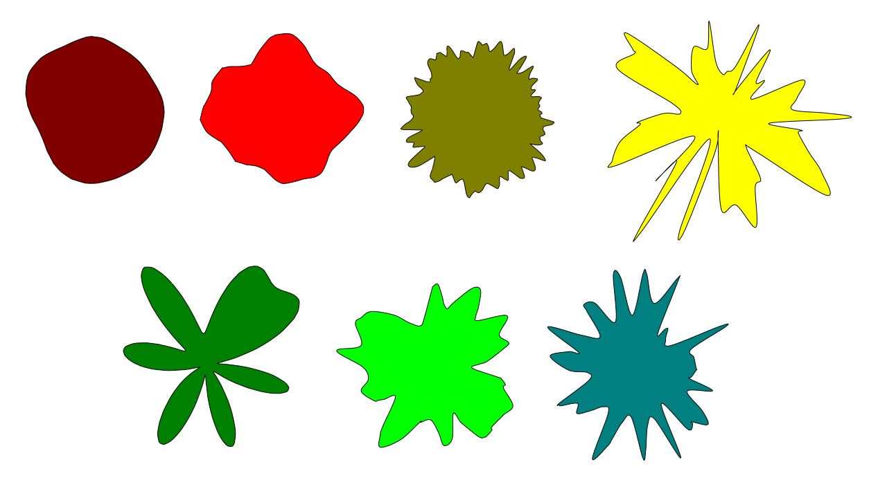

# Inkscape Noise Shape

Generates a random closed path shape using 2D Simplex Noise. Usable for generating:
- Organic shapes such as clouds, ink blots, cells, and island outlines
- Explosion or spike effects (large amplitude + high scale)
- Rough edges and torn-paper borders (high sample points + high scale)
- Icon backplates, sticker outlines, and background decorative blobs

## Features

- Seamless closed curve: noise is sampled once around a circle, so start and end match with no seam.
- Random angular spacing: 360° is split into random positive increments that always sum to 360°, so points are irregularly distributed but the shape still closes.
- Smooth output: Catmull-Rom splines converted to cubic Béziers, so the curve passes through every sample point without looking polygonal.
- No external dependencies: includes a lightweight Simplex Noise implementation, compatible with Inkscape's bundled Python.

## Install

Copy both files into your Inkscape extensions folder:

- **Linux:** `~/.config/inkscape/extensions/`
- **Windows:** `%APPDATA%\inkscape\extensions\`
- **macOS:** `~/Library/Application Support/org.inkscape.Inkscape/config/inkscape/extensions/`

Restart Inkscape.

Requires Inkscape 1.x (Python 3 + `inkex`).

## Usage

**Extensions → Generate from Path → Noise Shape**

Adjust the parameters and click **Apply**. The path is added to the current layer, centered on the current view.

## Parameters

| Parameter | Effect |
|---|---|
| Sample points | Higher = smoother, more detailed curve; lower = more angular, faster. |
| Base radius | Larger = bigger overall shape. |
| Noise amplitude | Larger = more irregular, spikier outline; smaller = closer to a circle. |
| Noise scale | Larger = finer, higher-frequency detail; smaller = broad smooth lumps. |
| Random seed | Same seed + same settings reproduce the same shape; change it for a different shape. |

## License

MIT